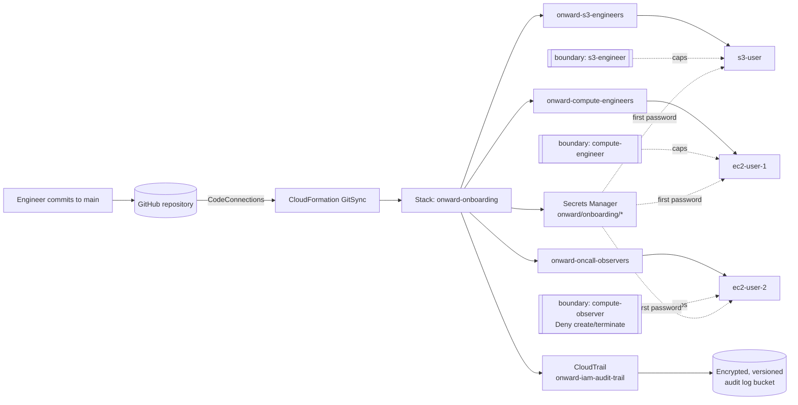

# Onward Logistics: Secure Onboarding at Scale

Automated, auditable, least-privilege AWS onboarding for new engineers, provisioned entirely with AWS CloudFormation and deployed through CloudFormation GitSync.

**Module:** Security & Identity Management on AWS · **Week:** 1

---

## Table of Contents

1. [Overview](#overview)
2. [Business Context](#business-context)
3. [Objectives](#objectives)
4. [Technical Requirements](#technical-requirements)
5. [Solution Architecture](#solution-architecture)
   - [Design Principles](#design-principles)
   - [Identity Model](#identity-model)
   - [Permissions Boundaries](#permissions-boundaries)
   - [Secure First Login](#secure-first-login)
   - [Audit Trail](#audit-trail)
6. [Repository Structure](#repository-structure)
7. [Prerequisites](#prerequisites)
8. [Deployment](#deployment)
9. [Configuration](#configuration)
10. [Verification and Evidence](#verification-and-evidence)
11. [Retrieving Initial Credentials](#retrieving-initial-credentials)
12. [Change Management](#change-management)
13. [Requirements Traceability](#requirements-traceability)
14. [Cleanup](#cleanup)
15. [Deliverables](#deliverables)

---

## Overview

Onward Logistics onboards five to ten engineers a month. Their access used to be set up by hand in the AWS console, and the result depended on which admin did the work. This repository replaces that process with a version-controlled CloudFormation template that:

- creates every identity the same way, every time, with no manual console steps
- grants each engineer the access their role needs and nothing more
- issues a generated first password that must be changed at first sign-in
- caps each user's maximum permissions with a permissions boundary, so later mistakes cannot widen access
- records every change to access in Git and in AWS CloudTrail

## Business Context

In planning, the client set three requirements:

> "We want new hire access built the same way every time, not configured manually by whoever is on shift that day."

> "We want a record of every change to who can access what, so we can answer who approved this and when during an audit."

> "We have engineers who only ever need to check on running instances … and they should never be able to spin up new compute. Not by accident, not months from now, and not even if someone on our team later loosens their group's permissions without realizing it."

## Objectives

| # | Objective | How it is met |
|---|-----------|---------------|
| 1 | Onboard three engineers with role-appropriate access only | Group-based access with AWS managed policies, capped by per-role permissions boundaries |
| 2 | Secure first login | Secrets Manager generates each password; `PasswordResetRequired: true` forces a change |
| 3 | On-call engineer can never create or terminate compute | Explicit `Deny` in the on-call permissions boundary, which no attached policy can override |
| 4 | Repeatable and auditable onboarding | CloudFormation GitSync from Git, `ApprovedBy` tags, and a CloudTrail audit trail |
| 5 | Prove every objective to the Head of Security | `scripts/evidence.sh` produces a pass/fail report from live AWS data |

## Technical Requirements

| Requirement | Status |
|-------------|--------|
| Provision everything with AWS CloudFormation | ✅ All resources are defined in `templates/onboarding-template.yaml` |
| Deploy with a GitSync-enabled stack from a version-controlled repository | ✅ `deployment.yaml` at the repository root |
| Generate the initial credential with AWS Secrets Manager | ✅ One generated secret per user, resolved by dynamic reference |
| No inline policies | ✅ No `AWS::IAM::Policy` resources and no `Policies:` properties |
| Cap entity permissions instead of writing per-entity policies | ✅ Reusable customer-managed permissions boundaries |

## Solution Architecture

> Full diagrams: [open in draw.io](https://app.diagrams.net/#Hjadofils%2Fonward-aws-lab-journal%2Fmain%2Fdocs%2Farchitecture.drawio). Pages: architecture, access change flow, on-call permission decision, secure first sign-in.



### Design Principles

- **Least privilege:** each role gets only the services its job requires.
- **Defense in depth:** group policies grant access, and permissions boundaries set a ceiling that group policies cannot exceed.
- **No inline policies:** access comes only from AWS managed policies attached to groups, plus reusable customer-managed boundaries.
- **Everything as code:** the stack can be rebuilt entirely from this repository.
- **Traceability:** every change is a Git commit, every identity is tagged with its approver, and every IAM API call is logged.

### Identity Model

| User | Role | Group | Group policies (AWS managed) | Permissions boundary |
|------|------|-------|------------------------------|----------------------|
| `s3-user` | Storage engineer | `onward-s3-engineers` | `AmazonS3FullAccess`, `IAMUserChangePassword` | `onward-boundary-s3-engineer` |
| `ec2-user-1` | Compute engineer | `onward-compute-engineers` | `AmazonEC2FullAccess`, `IAMUserChangePassword` | `onward-boundary-compute-engineer` |
| `ec2-user-2` | On-call observer | `onward-oncall-observers` | `AmazonEC2ReadOnlyAccess`, `IAMUserChangePassword` | `onward-boundary-compute-observer` |

Every user is tagged with `Role`, `ApprovedBy` and `Project`.

### Permissions Boundaries

A user's effective permissions are only what both their identity policies **and** their boundary allow. The boundary therefore sets the maximum access a user can ever have, whatever policies are attached later.

| Boundary | Allows | Explicitly denies |
|----------|--------|-------------------|
| `onward-boundary-s3-engineer` | `s3:*`, self-service password change | n/a |
| `onward-boundary-compute-engineer` | `ec2:*`, CloudWatch read, self-service password change | n/a |
| `onward-boundary-compute-observer` | `ec2:Describe*`, `ec2:GetConsoleOutput`, CloudWatch read, self-service password change | Creating or terminating compute (EC2, Spot, Fleet, launch templates, Auto Scaling, Lambda, ECS); removing or editing the boundary |

Because an explicit `Deny` always wins in IAM policy evaluation, `ec2-user-2` cannot create or terminate compute **even if `AdministratorAccess` is attached to the user or their group**. The evidence script's tamper test proves this.

### Secure First Login

1. CloudFormation creates one Secrets Manager secret per user (`onward/onboarding/<username>`) with a generated 24-character password.
2. The user's login profile reads the password through a dynamic reference (`{{resolve:secretsmanager:...}}`), so the password never appears in the template, in Git or in stack outputs.
3. `PasswordResetRequired: true` forces the engineer to set their own password at first sign-in.

### Audit Trail

- **Git history** shows who changed the access definition and when (`git log -- templates/onboarding-template.yaml`).
- **`ApprovedBy` tags** on every identity record who approved the access.
- **CloudTrail** (`onward-iam-audit-trail`) is a multi-region trail with global service events and log file validation. It writes to an encrypted, versioned, private S3 bucket that is kept even if the stack is deleted.
- **Drift detection** shows whether anyone changed IAM outside the template.

## Repository Structure

```
.
├── deployment.yaml                     # GitSync deployment file (must stay at the root)
├── templates/
│   └── onboarding-template.yaml        # CloudFormation template
├── scripts/
│   ├── create-deploy-role.sh           # One-time bootstrap: GitSync and deployment IAM role
│   └── evidence.sh                     # Verification and evidence collector
├── docs/
│   ├── architecture.drawio             # draw.io: architecture and flow diagrams (4 pages)
│   └── onward-lab-week-1-aws.md        # Lab brief and client requirements
└── README.md
```

## Prerequisites

- An AWS account where you are allowed to create IAM users, groups, policies, Secrets Manager secrets and CloudTrail trails
- A connection between AWS CodeConnections and this GitHub repository
- The deployment role `onward-cfn-deploy-role`, created once with `scripts/create-deploy-role.sh` (see [Deployment](#deployment))
- AWS CLI v2, configured with credentials for the target account (needed for the evidence script)
- Bash 4+ (Linux, macOS, WSL or Git Bash)
- Optional: [`cfn-lint`](https://github.com/aws-cloudformation/cfn-lint) for local validation

## Deployment

### Step 1: Create the deployment role (once per account)

GitSync needs an IAM role before the stack exists, so this role is created by a bootstrap script instead of the template. In **AWS CloudShell**, upload `scripts/create-deploy-role.sh` and run:

```bash
bash create-deploy-role.sh
```

The script creates `onward-cfn-deploy-role` with two customer-managed policies, and is safe to run again:

| Policy | Purpose |
|--------|---------|
| `onward-cfn-gitsync-policy` | Lets GitSync create and run change sets and watch the repository |
| `onward-cfn-deploy-policy` | Lets CloudFormation create only the resources in the template (`onward-*` IAM entities, `onward/onboarding/*` secrets, the audit bucket and trail) |

The role trusts both `cloudformation.sync.codeconnections.amazonaws.com` and `cloudformation.amazonaws.com`, so it can be used in both IAM role fields below.

### Step 2, Option A: CloudFormation GitSync (recommended)

1. Open **CloudFormation › Create stack › Sync from Git**.
2. Enter the following settings:

   | Setting | Value |
   |---------|-------|
   | Stack name | `onward-onboarding` |
   | Repository | this repository, through AWS CodeConnections |
   | Branch | `main` |
   | Deployment file path | `deployment.yaml` |
   | Git sync IAM role | `onward-cfn-deploy-role` |
   | Enable comment on pull request | On |
   | Stack IAM role (Permissions) | `onward-cfn-deploy-role` |
   | Capabilities | `CAPABILITY_NAMED_IAM` |

3. Create the stack. From then on, every merge to `main` updates the stack automatically, and CloudFormation comments the planned changes on each pull request.

### Step 2, Option B: AWS CLI (local testing)

```bash
cfn-lint templates/onboarding-template.yaml

aws cloudformation deploy \
  --stack-name onward-onboarding \
  --template-file templates/onboarding-template.yaml \
  --capabilities CAPABILITY_NAMED_IAM \
  --parameter-overrides ApprovedBy=head-of-security EnableAuditTrail=true
```

> Use Option B only in a sandbox account. In production, GitSync must be the only path to change the stack.

## Configuration

Set parameters in `deployment.yaml`:

| Parameter | Default | Description |
|-----------|---------|-------------|
| `ProjectTag` | `onward-logistics-onboarding` | Applied as the `Project` tag on all resources |
| `ApprovedBy` | `head-of-security` | Recorded as the `ApprovedBy` tag on every identity |
| `EnableAuditTrail` | `"true"` | Set to `"false"` if the account already has an all-region trail |

Stack tags (`Project`, `Owner`, `ManagedBy`, `CostCenter`) are also set in `deployment.yaml`.

## Verification and Evidence

`scripts/evidence.sh` checks every objective against live AWS data and writes a timestamped report.

```bash
# Read-only verification
./scripts/evidence.sh -s onward-onboarding -r eu-west-1

# Include the tamper test (temporarily attaches AdministratorAccess; lab accounts only)
./scripts/evidence.sh -s onward-onboarding -r eu-west-1 -t
```

| Option | Description | Default |
|--------|-------------|---------|
| `-s` | Stack name | `onward-onboarding` |
| `-r` | Region | `AWS_REGION` or the CLI default |
| `-o` | Output directory | `./evidence-<timestamp>` |
| `-t` | Run the tamper test | off |
| `-h` | Show help | n/a |

**What it checks**

| Section | Checks |
|---------|--------|
| Provisioning | Stack health, GitSync configuration, no configuration drift |
| Policy hygiene | No inline policies in the stack, template, users or groups |
| Identity design | Correct group, boundary and `ApprovedBy` tag per user; no directly attached policies |
| Secure first login | Secret exists; password reset required or already completed; template uses dynamic references |
| Day-one access | IAM policy simulation of allowed and denied actions for each engineer |
| On-call guarantee | `ec2-user-2` is denied create/terminate actions, including after AdministratorAccess is attached (`-t`) |
| Auditability | Trail is logging; recent IAM change events with time, event and actor |

The script exits `0` when every check passes and `1` otherwise. Evidence files (stack resources, deployed template, boundary document, drift details and CloudTrail events) are saved in the output directory.

## Retrieving Initial Credentials

An administrator retrieves each first password and gives it to the engineer through a secure channel:

```bash
aws secretsmanager get-secret-value \
  --secret-id onward/onboarding/s3-user \
  --query SecretString --output text
```

The engineer signs in to the AWS console and must set a new password immediately.

## Change Management

1. Create a branch from `main` (for example `feat/onboard-<username>`).
2. Edit `templates/onboarding-template.yaml`. To add an engineer, add a secret, a user, a group membership, a boundary and tags, following the existing users.
3. Run `cfn-lint` and update `scripts/evidence.sh` if names change.
4. Open a pull request that states who needs the access, why, and who approved it.
5. After review and merge, GitSync deploys the change, and Git plus CloudTrail record who made it and when.

Never change IAM resources from this stack in the console. Drift detection reports any such change.

## Requirements Traceability

| Client check | Evidence |
|--------------|----------|
| Each engineer can do their job on day one, and cannot do more | Day-one access section (IAM policy simulation) |
| The on-call engineer still cannot create or terminate compute after extra permissions are added | On-call guarantee section with `-t` |
| The Head of Security can see how access was defined and who changed it | Git history, `ApprovedBy` tags, CloudTrail events, deployed template |
| The whole setup can be rebuilt from the repository | GitSync stack with zero drift |

## Cleanup

```bash
aws cloudformation delete-stack --stack-name onward-onboarding
```

The CloudTrail log bucket uses `DeletionPolicy: Retain` so that audit records are kept. Empty it and delete it manually if it is no longer needed. Remove the GitSync configuration in CloudFormation before you delete the repository connection.

## Deliverables

- **Discovery report:** research report and business value
- **Repository:** this repository, containing the CloudFormation template
- **Architecture diagram:** [open in draw.io](https://app.diagrams.net/#Hjadofils%2Fonward-aws-lab-journal%2Fmain%2Fdocs%2Farchitecture.drawio) ([source file](docs/architecture.drawio)); summary in [Solution Architecture](#solution-architecture)
- **Live review:** explanation and defense of the design decisions
